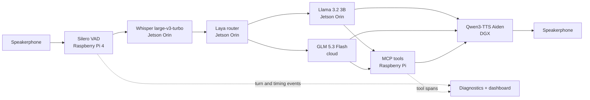

# ME3 | Full-duplex voice agent on an edge–cloud cluster

An **MLOps course project** exploring how to operate, observe, and evaluate an interruptible voice agent across constrained edge hardware and remote inference services. A Raspberry Pi 4 runs the Pipecat audio pipeline and MCP tool servers; a Jetson Orin serves speech recognition, routing, and a local language model; a cloud model handles more complex requests; and a DGX serves streaming speech synthesis.

The project is a working research prototype, not a production service. Its main contribution is the integration and operational evaluation of these components: turn-taking, confidence-aware routing, tool execution, service placement, diagnostics, and repeatable latency experiments.

## System at a glance



Routing depends on the request, confidence, and safety/fallback rules; this diagram shows possible paths, not a claim that every turn uses every component. The current direct-socket speech setup differs from the separately evaluated Pi-hosted ASR/TTS MCP proxy setup. Model names refer to the configurations in the November 2026 experiments; older runbooks describe earlier configurations.

## Evaluation snapshot

In one matched benchmark session, 10 phrases were repeated three times per configuration with natural local/cloud routing and filler audio disabled. The table reports mean / p95, with the number of recorded observations in parentheses. Targets are project goals, not claims of compliance.

| Metric | Target | Direct sockets | Pi speech MCP proxies |
| --- | ---: | ---: | ---: |
| End-to-end, VAD end → audio output | < 4.0 s | 5.32 / 8.16 s (30) | 5.44 / 8.56 s (30) |
| ASR final | < 0.8 s | 1.39 / 1.93 s (30) | 1.11 / 1.33 s (30) |
| LLM time to first token | < 1.5 s | 3.59 / 6.72 s (27) | 3.48 / 5.82 s (27) |
| TTS time to first audio | < 0.6 s | 0.18 / 0.38 s (30) | 0.52 / 0.76 s (30) |
| ASR word error rate | — | 3.8% (30) | 3.8% (30) |

A separate interruption test recorded **0.32 s mean / 0.53 s p95** stop time for 25 measurable overlaps, against a 0.8 s target. It attempted 30 clips: 27 overlapped playback and two of those did not yield a measurable stop time. These results are not a general guarantee: the phrases were repeated, the comparison was not randomized, and a physical speakerphone check was limited to one functional example. See the [evaluation notes](docs/portfolio/evaluation.md) for definitions, sample gaps, and provenance.

## MLOps work demonstrated

- **Serving and orchestration:** separate ASR, router, local LLM, cloud LLM, and TTS services connected by the Pi-hosted pipeline, with an alternative speech MCP deployment for placement experiments.
- **Routing and tool use:** Laya classifies requests, local handling reduces unnecessary cloud calls, and complex or uncertain requests can fall back to GLM. MCP tools provide voice actions and workspace operations.
- **Observability:** per-turn JSONL events and tool spans feed a FastAPI/React dashboard with routing traces, a latency waterfall, run comparisons, and simulated-device activity.
- **Evaluation:** stage timestamps, WER, interruption trials, and a separately enabled LLM judge support analysis of both responsiveness and answer relevance. Raw run artifacts can contain sensitive conversation data and are not all published.
- **Reliability:** audio interruption and ASR completion are coordinated; long-running requests use non-failure progress audio; the project records operational tests and rollback procedures.

For concrete live-demo failures, fixes, and evidence, see the [demo analysis](docs/runbooks/demo-evidence-20261107.md). For component boundaries and operational caveats, see the [architecture and operations notes](docs/portfolio/architecture.md).

## Explore the dashboard locally

The dashboard can be explored without the Pi or model servers using the committed sample diagnostics. From the repository root:

```bash
python3 -m venv .venv
.venv/bin/python -m pip install -r dashboard/requirements.txt
cd dashboard/frontend
npm ci
npm run build
cd ../..
.venv/bin/python -m uvicorn backend.app:app --app-dir dashboard --host 127.0.0.1 --port 8000
```

Open <http://127.0.0.1:8000/>. This starts the visualization only, not the voice pipeline. The dashboard reconstructs some state from recorded tool events; simulated-device panels are not evidence of physical smart-home control. See the [dashboard runbook](dashboard/runbook.md) for data ingestion and metric interpretation. Paths and SSH settings in older runbooks are environment-specific.

## Repository guide

| Path | Contents |
| --- | --- |
| [`pi/`](pi/) | Audio pipeline, routing, diagnostics, speech adapters, and MCP servers |
| [`dashboard/`](dashboard/) | FastAPI backend, React/TypeScript UI, and sample diagnostics |
| [`deploy/`](deploy/) | Service definitions and deployment components for the cluster |
| [`scripts/`](scripts/) | Profiling, trial summaries, and operational utilities |
| [`tests/`](tests/) | Unit and integration-oriented regression tests |
| [`docs/runbooks/`](docs/runbooks/) | Dated deployment experiments, live findings, and rollbacks |
| [`docs/profiling/`](docs/profiling/) | Selected profiling artifacts and comparison data |
| [`docs/portfolio/`](docs/portfolio/) | Architecture and evaluation guide for reviewers |

Full cluster operation requires the Pi, Jetson, DGX, network access, model services, and private credentials configured outside the repository. The checked-in [`pi/env.example`](pi/env.example) contains historical defaults and must be reviewed for the chosen deployment; it is not a turnkey current configuration. Third-party provenance is recorded in [NOTICE.md](NOTICE.md).
