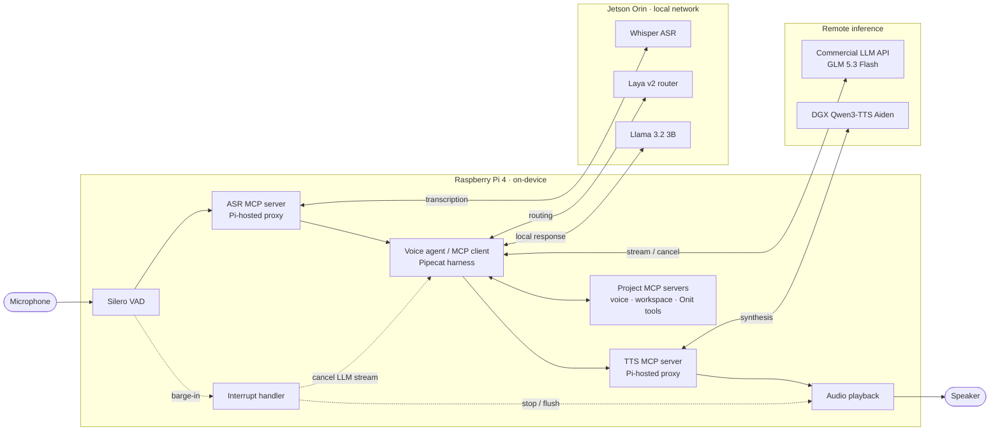

# ME3 | Full-duplex voice agent on an edge–cloud cluster

An **MLOps course project** exploring how to operate, observe, and evaluate an interruptible voice agent across constrained edge hardware and remote inference services. A Raspberry Pi 4 runs the Pipecat audio pipeline and MCP tool servers; a Jetson Orin serves speech recognition, routing, and a local language model; a cloud model handles more complex requests; and a DGX serves streaming speech synthesis.

The project is a working prototype, not a production service. Its main contribution is the integration and operational evaluation of these components: turn-taking, confidence-aware routing, tool execution, service placement, diagnostics, and repeatable latency experiments.

## System at a glance



**Deployment boundary:** The diagram shows the evaluated Pi-hosted speech MCP configuration: our ASR, TTS, and application MCP servers execute on the Pi, while ASR inference runs on the Jetson and TTS inference runs on the DGX. The **normal live configuration uses direct speech connections** to the same inference services instead of the two speech MCP proxies; application MCP servers remain on the Pi. Pipecat is the harness actually used here; Onit refers to an MCP tool server, not a second harness. Laya can route requests to the local Llama model or the commercial GLM API, subject to confidence and fallback rules.

When a user interrupts during speech, the Pi interruption handler requests that playback be stopped and queued audio flushed, and cancels the active LLM response stream. See the [demo evidence](docs/runbooks/demo-evidence-20261107.md) for observed interruption behavior and the remaining ASR timing limitation. Model names refer to the November 2026 experiments; older runbooks describe earlier configurations.

## Live demo and generated dashboard

The demonstration asks the agent to describe its models and tools, interrupts it to request a web dashboard, and then has it create, serve, and send a link to Telegram. The user subsequently asked it to add the pipeline and rearrange the page. The [final generated HTML snapshot](docs/portfolio/demo/dashboard.html) preserves that revised two-column page: system cards on the left, pipeline on the right. Private LAN endpoint addresses in the snapshot are replaced with descriptive labels. GitHub displays HTML source; to view the rendered snapshot locally, from the repository root run:

```bash
python3 -m http.server 8080 --directory docs/portfolio/demo
```

Open <http://127.0.0.1:8080/dashboard.html>. This is a static demo artifact, separate from the operational dashboard described below. It represents startup configuration and is not a live health display. The original page on the Pi is available on the cluster at `http://192.168.5.12:8000/dashboard.html` while its temporary server is running.

| Demo result | Observed evidence |
| --- | --- |
| Inventory | The live retest named the active models and three registered MCP servers; the inventory call took 3.2 ms. |
| Interruption | A retest interrupted with 1.888 s of queued audio; flush initiation followed the turn-start event by about 21 ms. This is not measured acoustic stop latency. |
| Create and deliver | The user confirmed the Telegram link worked. Later edits were accepted by Telegram; an edit failure was recovered by rewriting the file. |
| Slow response | The neutral third progress clip fired at 18 s in a subsequent live request; a repeat was skipped after an answer. |

See the [live demo report and latency chart](docs/portfolio/demo-results/live-demo-report.md) and the [stage-by-stage demo evidence](docs/runbooks/demo-evidence-20261107.md) for the ASR race, task-completion times, and what remains unverified.

## Fine-tuning Laya v2

The local router is a fine-tuned **Laya v2 nine-group classifier**. Its [model and training report](Laya%20finetuning/v2/README.md) connects the checkpoint to its [pipeline contract](pi/laya_contract_v2.py), training data, calibration, held-out evaluation, and limitations. The broader [Laya fine-tuning folder](Laya%20finetuning/README.md) also documents the earlier v4 model; weights and datasets are not bundled.

## Evaluation snapshot

In one matched benchmark session, 10 phrases were repeated three times per configuration with natural local/cloud routing and filler audio disabled. The table reports mean / p95, with the number of recorded observations in parentheses. Targets are project goals, not claims of compliance.

| Metric | Target | Direct sockets | Pi speech MCP proxies |
| --- | ---: | ---: | ---: |
| End-to-end, VAD end → audio output | < 4.0 s | 5.32 / 8.16 s (30) | 5.44 / 8.56 s (30) |
| ASR final | < 0.8 s | 1.39 / 1.93 s (30) | 1.11 / 1.33 s (30) |
| LLM time to first token | < 1.5 s | 3.59 / 6.72 s (27) | 3.48 / 5.82 s (27) |
| TTS time to first audio | < 0.6 s | 0.18 / 0.38 s (30) | 0.52 / 0.76 s (30) |
| ASR word error rate | — | 3.8% (30) | 3.8% (30) |

A separate interruption test recorded **0.32 s mean / 0.53 s p95** stop time for 25 measurable overlaps, against a 0.8 s target. It attempted 30 clips: 27 overlapped playback and two of those did not yield a measurable stop time. These results are not a general guarantee: the phrases were repeated, the comparison was not randomized, and a physical speakerphone check was limited to one functional example. See the [evaluation notes](docs/portfolio/evaluation.md) for definitions, sample gaps, and provenance.

## Versioned system prompts

The [prompt index](prompts/README.md) links the versioned voice and Telegram instructions to their runtime sources. Routing and safety checks are also implemented in code; prompt snapshots are tested against the instructions actually sent to the model.

## Context engineering

The voice agent combines a [versioned system prompt](prompts/README.md), conversation turns and MCP results with VAD and ASR events that control when a turn is ready. Whisper supports rolling partials and final transcripts; interruptions stop stale playback and cancel the active response. Memory/RAG is optional and is not claimed as a general subsystem.

The cloud path limits completions to 4,096 tokens and trims old turns against a 24,000-character soft history limit; this is not a hard input-token cap. Per-run logs record context size and provider token usage. OpenRouter requests include a stable session ID for prefix reuse, but an actual cache hit and TTFT improvement remain unverified. In one direct benchmark run, reported prompt context was **1,867 tokens median / 3,549 maximum** and **31 messages median / 63 maximum**. See [context engineering](docs/portfolio/context-engineering.md) for scope, implementation references, and measurement limits.

## MLOps work demonstrated

- **Serving and orchestration:** separate ASR, router, local LLM, cloud LLM, and TTS services connected by the Pi-hosted pipeline, with an alternative speech MCP deployment for placement experiments.
- **Routing and tool use:** Laya classifies requests, local handling reduces unnecessary cloud calls, and complex or uncertain requests can fall back to GLM. MCP tools provide voice actions and workspace operations.
- **Observability:** per-turn JSONL events and tool spans feed a FastAPI/React dashboard with routing traces, a latency waterfall, run comparisons, and simulated-device activity.
- **Evaluation:** stage timestamps, WER, interruption trials, and a separately enabled LLM judge support analysis of both responsiveness and answer relevance. Raw run artifacts can contain sensitive conversation data and are not all published.
- **Reliability:** audio interruption and ASR completion are coordinated; long-running requests use non-failure progress audio; the project records operational tests and rollback procedures.

For concrete live-demo failures, fixes, and evidence, see the [demo analysis](docs/runbooks/demo-evidence-20261107.md). For component boundaries and operational caveats, see the [architecture and operations notes](docs/portfolio/architecture.md).

## Explore the operational dashboard locally

The dashboard can be explored without the Pi or model servers using the committed sample diagnostics. From the repository root:

```bash
python3 -m venv .venv
.venv/bin/python -m pip install -r dashboard/requirements.txt
cd dashboard/frontend
npm ci
npm run build
cd ../..
.venv/bin/python -m uvicorn backend.app:app --app-dir dashboard --host 127.0.0.1 --port 8000
```

Open <http://127.0.0.1:8000/>. This starts the visualization only, not the voice pipeline. The dashboard reconstructs some state from recorded tool events; simulated-device panels are not evidence of physical smart-home control. See the [dashboard runbook](dashboard/runbook.md) for data ingestion and metric interpretation. Paths and SSH settings in older runbooks are environment-specific.

## Repository guide

| Path | Contents |
| --- | --- |
| [`pi/`](pi/) | Audio pipeline, routing, diagnostics, speech adapters, and MCP servers |
| [`dashboard/`](dashboard/) | FastAPI backend, React/TypeScript UI, and sample diagnostics |
| [`deploy/`](deploy/) | Service definitions and deployment components for the cluster |
| [`scripts/`](scripts/) | Profiling, trial summaries, and operational utilities |
| [`tests/`](tests/) | Unit and integration-oriented regression tests |
| [`docs/runbooks/`](docs/runbooks/) | Dated deployment experiments, live findings, and rollbacks |
| [`docs/profiling/`](docs/profiling/) | Selected profiling artifacts and comparison data |
| [`docs/portfolio/`](docs/portfolio/) | Architecture and evaluation guide for reviewers |

Full cluster operation requires the Pi, Jetson, DGX, network access, model services, and private credentials configured outside the repository. The checked-in [`pi/env.example`](pi/env.example) contains historical defaults and must be reviewed for the chosen deployment; it is not a turnkey current configuration. Third-party provenance is recorded in [NOTICE.md](NOTICE.md).
