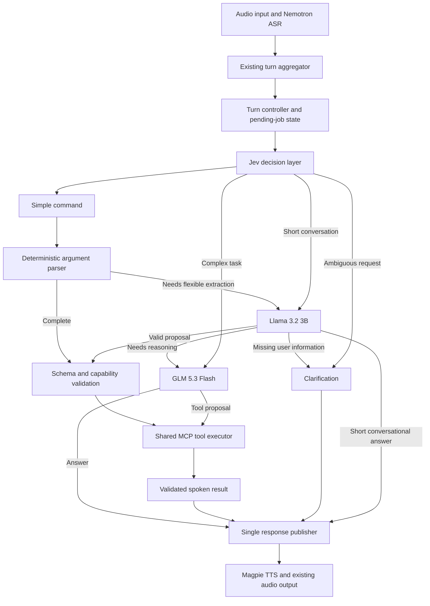

# Two brains plus Jev: orchestration plan

Status: pilot running on the Pi-local speakerphone bot; uncommitted.
Date: 2026-10-31. Branch: `two-brain-plusjev`.
Base: `main`, `187604fdf353ebe5e6f42edaf6a9d651e435abc7`.

## Objective

Reduce command-response latency by keeping routine VCM-derived tools off the
GLM reasoning path. Use Jev for routing, Llama 3.2 3B for bounded extraction
and short conversation, and GLM 5.3 Flash for complex work. Preserve the
existing MCP tool interface, Pi-local audio, WebRTC, interruption behavior,
and a runtime return to the current single-model pipeline.

Implementation status and test limits are recorded in
`docs/runbooks/two-brain-plusjev.md`. Model services and tunnels are running;
the Pi-local speakerphone bot now loads this branch's router. The first live
WebRTC session is assessed in `docs/runbooks/live-latency-20261031.md`.

## Evidence and deployment roles

- Pi: orchestration, Silero VAD, turn aggregation, MCP tools and persistent
  tool state. Current project is `/home/aldwinrpi4/voice-agent`.
- Jetson: Nemotron streaming ASR at `192.168.5.11:50051`, Magpie TTS at
  `192.168.5.11:50052`. Keep these workloads on the Jetson. Last inspection
  showed 7.3 GiB RAM total and about 1.7 GiB available.
- ThinkPad: preferred Llama 3.2 3B endpoint, served by a persistent
  `llama-server` user service. Its SSH reverse tunnel reaches Pi loopback
  port 18080. The loaded model ID is `llama3.2:3b`.
- Personal VPS: alternate Llama 3.2 3B endpoint, served by the enabled
  `llama-server.service` as `llama3.2-3b` on VPS loopback port 8010. A
  persistent Pi SSH tunnel reaches it on Pi loopback port 18081. Completion
  requests require an API key stored in private files on the two hosts.
- TypeSafe: hosted Jev decision endpoint; the user has API access. Do not
  assume the key is already configured on the Pi.
- OpenRouter: active environment selects `z-ai/glm-5.3-flash`; repository
  defaults and greeting still reference Ollama Cloud. Separate the provider
  configuration explicitly during implementation.

Latest six-turn baseline: turn-completion event to software audio onset was
5.13, 8.97, 9.83, 9.40, 12.37 and 9.64 seconds. Lights took 17 ms in its
tool, but about 7.68 seconds across two LLM calls. Magpie first audio took
0.88–1.01 seconds. Thermostat tool execution took an unexplained 3.63 seconds.
These are samples, not p50/p95 measurements; physical speech end and audible
speaker onset were not recorded. Source: Pi `me3-local-audio.log`, session
starting 19:31 on 2026-10-31.

## Proposed data flow



Jev is an independent hosted classifier, not a plugin inside either LLM.
The controller runs on the Pi. A complex request goes straight from Jev to
GLM; it does not pay for a small-model completion first. Confidently parsed
commands bypass Llama as well. Do not run every request serially through
Jev, Llama, GLM and another Llama response.

## Decision contract

One bounded Jev request per completed user turn, containing transcript,
recent relevant turns, pending clarification/job, available capabilities,
and known resolved entities. Exclude unnecessary tool payloads and secrets.
Ask independent focused questions together:

1. `intent`: one of the available tool families, short conversation,
   complex task, or unknown.
2. `handling`: single supported command, clarification, or reasoning.
3. `pending_reference`: whether this changes/cancels an existing request.
4. `multiple_actions`: whether coordinated actions are requested.

Use the native `JevClassifier` and shared `JevClient` under
`pipecat.classifiers.typesafe.jev`. Explicitly select a version; compare
`jev-1.14.0` against 1.13 before fixing thresholds. Do not inherit an older
library default accidentally. Warm the shared connection during setup.

Initial experimental gate: selected option probability >=0.90 and gap to
runner-up >=0.20 for direct execution, plus valid arguments and an allowed
capability. These are tuning candidates, not calibrated acceptance criteria.
Treat Jev's distribution-derived `confidence` separately from the selected
option probability. Select final thresholds using held-out utterances.

The controller owns the decision. Neither Jev confidence nor Llama's claim
that it can handle a request overrides schema validation or capability state.
Ambiguous ASR entities need clarification; a larger model cannot establish
what the user actually said.

## Small brain: Llama 3.2 3B

Use ThinkPad first when healthy and awake. Keep a warm connection and model
where the serving engine supports it. Use VPS when ThinkPad is unavailable
or measurements justify VPS preference. Never put another LLM on the Jetson
as part of this change.

For argument extraction, provide only the selected tool schema, transcript,
relevant resolved state and bounded examples. Require a discriminated result:

```json
{
  "status": "tool",
  "tool": "set_thermostat",
  "arguments": {"degrees": 26}
}
```

Other schema variants are `clarify` with enumerated missing fields,
`escalate` with an enumerated reason, and `answer` for short non-tool replies.
Forbid invented tool names, extra fields, and arbitrary code. Validate all
arguments server-side. Do not trust self-reported model confidence. Limit
generation length, context, retries and sampling variation. A malformed or
unsupported proposal gets at most one bounded escalation, not a repair loop.

If endpoints use Ollama, use its native schema-constrained output for
extraction; verify equivalent capability if served by llama.cpp or another
engine. JSON validity alone does not establish argument correctness.
Both ThinkPad and VPS must pass the same tool-contract suite; record model
digest/quantization and prompt version so failover is reproducible.

For simple tools, speak the tool's `spoken` field immediately. Do not ask
Llama or GLM to rewrite it. Greeting, short acknowledgments and missing-field
questions can use templates. Use Llama for short conversation where useful.

## Tool allocation and existing limitations

| Tool family | Proposed handling | Important condition |
|---|---|---|
| Time, list reminders | Direct after routing | No LLM argument extraction needed |
| Lights, thermostat, timer | Deterministic parser, Llama if needed | Enforce actual enums/ranges, including thermostat 16–32 C |
| Alarm, reminder creation | Llama extraction with deterministic time validation | Clarify ambiguous times; preserve exact reminder text |
| Weather | Fast path with resolved/default location | Resolve place names explicitly; do not invent coordinates from ASR noise |
| Music, radio | Llama query extraction, existing search tool | Current tools return metadata/state; actual playback is a separate missing capability |
| Playback controls | Fast path only when supported | Current implementation stores state; do not claim a real player changed |
| Messages, email, calls | Initially GLM or explicit clarification workflow | Preserve exact recipient/content and existing authorization behavior |
| Explanation, comparison, multi-step task | GLM directly | Give only relevant tools and bounded state |

Lights and thermostat currently write stored state rather than physical
devices. Calls are a stub. Timers/alarms require a separate audit of actual
firing behavior before presenting them as working notifications. Route
selection must reflect implemented capability rather than tool name alone.
Both brains share one authoritative tool registry and MCP execution path.

## GLM escalation

Escalate for reasoning, multi-action coordination, unsupported extraction,
or unresolved context that a model can actually resolve. Missing essential
user information leads to clarification instead. GLM receives the original
transcript, pertinent history, validated state, prior execution receipts,
and escalation reason. It must not re-execute completed actions.

Use separate cloud configuration; retain compatibility with legacy OLLAMA
variables during migration. Benchmark a supported lower-reasoning setting
for routine GLM work; do not assume every provider honors the same setting.
Stream the GLM answer directly to TTS through the shared response publisher.
For long tasks, one short acknowledgment may improve perceived response,
but measure time to useful result separately from acknowledgment onset.

## Pipecat integration and conversation ownership

Keep `transport.input -> stt -> user_aggregator` and the existing
`tts -> transport.output -> assistant_aggregator` chain. Replace the single
LLM slot with an orchestration processor/service boundary. Reuse installed
Pipecat APIs and verify frame contracts before coding.

`LLMWithBackend` is available for conversational delegation, but its frontend
delegation/relay cycle is optional, not a required stage on command turns.
Use explicit routing for the initial implementation. `LLMSwitcher` may
support selection between generative services; it does not implement Jev
policy, direct tool execution or result suppression by itself.

Maintain a single authoritative conversation ledger. Append each user turn
once and record model/route, validated tool call, result and spoken response.
Tool calls/results must remain valid paired messages if replayed into an
OpenAI-compatible LLM context. Record only actually spoken/interrupted
assistant content as appropriate; do not duplicate responses through both
the publisher and assistant aggregator. Use compact projections for Llama
and GLM rather than two divergent full histories.

Only one response publisher and TTS stream own the turn. Correlate all work
with session ID, turn ID and generation ID. On interruption, cancel stale
inference/TTS and discard late output. Route corrections to their pending
job. Canceling speech does not undo a completed external action.

Give each execution a durable receipt keyed by turn/tool/validated arguments.
The local dispatcher must avoid duplicate submissions. A timeout after
dispatch has an unknown outcome until reconciled; do not replay a mutating
tool on another endpoint. Existing external tools do not guarantee
exactly-once behavior; receipts cannot manufacture that guarantee.

## Deadlines, endpoint selection and failures

Initial benchmark budgets, configurable rather than hard latency promises:

| Stage | Initial deadline | Failure behavior |
|---|---:|---|
| Jev classification | 800 ms total | Use validated deterministic route if unambiguous, otherwise GLM/clarification |
| Llama extraction | 1.5 s total | Escalate once or clarify; do not execute invalid output |
| Local state tool | 500 ms warning threshold | Instrument dispatch/database; reconcile outcome before retry |
| Network tool | Per-tool budget | Speak a useful timeout result; avoid hidden long retries |

Configure Jev retry behavior explicitly so library defaults cannot turn an
800 ms budget into several long retries. Health probes and circuit breakers
should select a ready small-model host before a turn. After a mid-turn
failure, choose one recovery path within the remaining budget: VPS or GLM,
not an unbounded ThinkPad -> VPS -> GLM chain. Background recovery does not
block the current request. Log cold loads separately from warm inference.

Do not assume WSL localhost is reachable from the Pi. Verify ThinkPad LAN
reachability, Windows/WSL forwarding and firewall behavior read-only first.
Use a private authenticated route to the VPS; do not expose an unauthenticated
model port publicly. Keep credentials outside Git and redact request logs.
No live endpoint configuration is changed by this plan.

## Proposed implementation files and configuration

- `pi/orchestration/contracts.py`: route, extraction, capability and receipt types.
- `pi/orchestration/decision.py`: Jev questions, gates, timeout and metrics.
- `pi/orchestration/small_brain.py`: ThinkPad/VPS extraction adapter and health.
- `pi/orchestration/controller.py`: route state, escalation and turn ownership.
- `pi/orchestration/tool_executor.py`: shared MCP adapter, validation and receipts.
- `pi/orchestration/context.py`: bounded context projections and execution ledger.
- `pi/bot.py`: optional orchestration wiring; preserve existing single-model mode.
- `pi/env.example`: documented placeholders, no real hosts/keys guessed.
- `tests/orchestration/` and `evals/two-brain/`: contract and behavioral cases.
- `docs/runbooks/two-brain-plusjev.md`: implementation-era setup, metrics and rollback.

Proposed settings: `ORCHESTRATION_MODE=single|shadow|two_brain_plusjev`,
`TYPESAFE_API_KEY`, `JEV_MODEL`, `JEV_DEADLINE_MS`, `SMALL_LLM_MODEL`,
`SMALL_LLM_PRIMARY_URL`, `SMALL_LLM_SECONDARY_URL`, per-endpoint auth,
`SMALL_LLM_DEADLINE_MS`, `COMPLEX_LLM_BASE_URL`, `COMPLEX_LLM_MODEL`,
`COMPLEX_LLM_API_KEY`. Choose adapter/protocol after endpoint inspection.
Default remains `single` until the rollout gates pass.

## Validation, latency goals and staged rollout

1. Verify endpoints and installed classifier dependencies read-only. Capture
   serving versions, exact Llama model identities, warm/cold behavior and
   direct Pi-to-endpoint timings. Do not assume VPS is slower than ThinkPad.
2. Instrument baseline with monotonic timestamps: acoustic/VAD speech end,
   ASR final, turn completion, Jev start/end, Llama first token/validated
   output, GLM first token/answer token, MCP dispatch/result, TTS request/first
   PCM, transport write and sink-monitor onset. Record reasoning tokens,
   provider and audio buffering separately. Sink onset is not acoustic onset.
3. Build a labeled replay set covering all VCM intents, paraphrases, noisy
   ASR, missing fields, negation, corrections, follow-up references,
   multiple actions and unsupported requests. Use a held-out set for gates.
4. Run shadow mode: existing GLM path executes once; Jev/Llama only propose
   decisions. No shadow side effects or second spoken response. Measure the
   added load and keep shadow measurements distinct from live routing.
5. Test policy contracts and Pipecat frame behavior with fake MCP tools and
   controllable model delays. Test duplicate prevention, unknown outcomes,
   partial speech, stale results, barge-in, deadline expiry and host failure.
   Verify context parity after direct-tool and GLM turns.
6. Enable one fast tool family at a time in an isolated test invocation.
   Validate local and WebRTC transports; keep the production service stopped
   or unchanged until a live test is requested. Never run duplicate test bots
   against the same speakerphone or real action backends.
7. Compare at least 30 warm trials per representative route and separate cold
   trials. Report p50/p95, correctness, escalation and clarification rates,
   timeout rates and total useful-response latency. Prefer correctness over
   fast but wrong commands; manually adjudicate action proposals.

Initial goals, to revise after endpoint measurements: warm Jev p95 <=500 ms,
validated Llama extraction p95 <=1 s; direct local command audio onset p50
<=2 s and p95 <=3 s after turn completion. Aim for >=50% improvement over
matched command baselines, >=99% precision on auto-executed held-out command
proposals, and zero duplicate executions in fault-injection cases. These are
targets, not observed results or statistical guarantees. Network tool time
and the thermostat storage outlier may prevent individual routes meeting them.
Report physical speech-to-audio separately when captured.

Rollback: select `ORCHESTRATION_MODE=single` and restart only the test/new
service when authorized. Preserve MCP DB/receipts and logs; do not roll back
completed actions. Keep VAD, ASR endpointing, pacat buffer and audio volume
unchanged during routing comparisons so measurements isolate this change.

## Review checkpoints and open inputs

- Confirm exact ThinkPad and VPS URLs, serving engines, model tags/digests,
  network access and authentication without placing secrets in this file.
- Choose the Jev version after replay; establish whether the API key is
  available to the Pi through the existing secure environment mechanism.
- Validate the Llama 3B's extraction quality before enabling broad tool access.
- Agree which currently simulated capabilities should be exposed, and align
  spoken results with their real behavior.
- Review this plan before code implementation and before any Git commit.
  This branch is local; publishing it is not necessary for this review.

## References

- [Pipecat JevClassifier](https://docs.pipecat.ai/api-reference/server/classifiers/jev):
  native classifier, shared connection and configuration.
- Installed Pipecat 1.13 source on the Pi: `pipeline/llm_with_backend.py`,
  `pipeline/llm_switcher.py`, `classifiers/typesafe/jev/`.
- [TypeSafe primitives](https://docs.typesafe.ai/primitives) and
  [confidence](https://docs.typesafe.ai/confidence): typed decisions and semantics.
- [TypeSafe models](https://docs.typesafe.ai/models): explicit version selection.
- [Ollama structured outputs](https://docs.ollama.com/capabilities/structured-outputs):
  schema-based extraction if the installed endpoints use Ollama.
- [OpenRouter reasoning controls](https://openrouter.ai/docs/guides/best-practices/reasoning-tokens):
  provider-dependent reasoning configuration for GLM experiments.
- Existing repository: `pi/bot.py`, `pi/mcp_servers/voice_tools_mcp_server.py`,
  `docs/runbooks/milestone-5.md`. Historical runbooks are context, not live truth.
