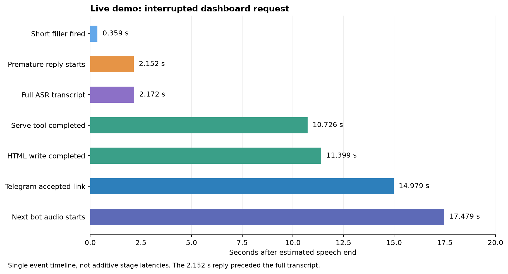

# Live demo task: latency and benchmark evidence

**Run:** `cd0cf4c88e` · **Date:** 7 November 2026, approximately 05:34, Asia/Manila (UTC+8) · **Task:** interrupt the model inventory response and ask the agent to create an HTML dashboard and send its link to Telegram. This is one live demo, not the 30-sample benchmark. The user confirmed the Telegram link worked. The later dashboard rearrangement requests are summarized separately below.

[Download vector chart (SVG)](live-demo-latency.svg) · [Chart script](plot_demo.py) · [Full stage-by-stage demo analysis](../../runbooks/demo-evidence-20261107.md)

## Benchmark table for this live task

Targets are the project goals. `n` counts usable observations **from this task only**. A single observation cannot support a meaningful p95; the event-based measurements below are not necessarily the same as a controlled benchmark result.

| Metric | Target | Live task observation | n | Interpretation |
| --- | ---: | ---: | ---: | --- |
| End-to-end: speech end → answer audio | < 4.0 s | Not valid for this task | 0 | A reply started at 2.152 s but it was premature: the full transcript arrived at 2.172 s. A later audio event occurred at 17.479 s, but the turn ID changed and its speech-end reference was not recorded. Filler audio was enabled. Neither is a valid filler-free E2E score. |
| ASR final: speech end → complete transcript | < 0.8 s | **2.172 s** | 1 | Estimated speech end to the 100-character final ASR transcript. The ASR HTTP request itself took 1.862 s; these have different boundaries. |
| LLM time to first token | < 1.5 s | Not recorded | 0 | No reliable transcript-to-first-token mark is present for the task. |
| TTS time to first audio | < 0.6 s | **0.150 s** | 1 | First TTS chunk for the first bot audio event after the dashboard request's tool work; it was a 5-character synthesis, not a full-answer E2E time. |
| Barge-in: user speech → playback stopped | < 0.8 s | Not measured acoustically | 0 | Turn-start event to flush initiation was approximately **0.021 s** with 1.888 s queued. This is a control-event interval, not microphone-to-audible-stop latency. |
| Word error rate | < 15% | Not measured | 0 | No aligned reference transcript was captured for scoring this live task. |

The task used natural routing and filler audio. Do not calculate a mean or p95 across unrelated demo events, treat the premature reply as a successful answer, or substitute the separate benchmark's numbers for this task.

## Task timeline and outcome

Relative to estimated speech end at 05:34:26.505:

| Event | Offset | Evidence |
| --- | ---: | --- |
| Short filler fired | 0.359 s | `bc_fired` speech-end field; not an answer. |
| Premature reply began | 2.152 s | `bot_started`; the short ASR fragment led to an irrelevant early response. |
| Full ASR transcript | 2.172 s | 100-character finalized transcript; arrived about 20 ms after bot audio began. |
| `serve` completed | 10.726 s | Existing web server reused; server call duration 45.1 ms. |
| `write_file` completed | 11.399 s | Dashboard written; server call duration 725.9 ms. The server was already running. |
| Telegram accepted link | 14.979 s | `send_message` server call duration 1,030.0 ms. The user later confirmed the link opened. |
| Later bot audio started | 17.479 s | Event time derived from the earlier speech end; not an instrumented E2E for the new turn. |

The initial inventory request in this same run produced a bot-start event **8.245 s** after estimated speech end and an ASR final at **1.406 s**; these belong to a different request. Its inventory MCP call took **3.2 ms**. The ASR race observed during interruption motivated the later latest-segment guard; the guard was not present in this demo run.

## State and model versions

| Item | State / provenance |
| --- | --- |
| Device | Raspberry Pi 4 Model B Rev 1.5; 4 GB installed (prior benchmark hardware report). A later OS check reported 3,885,816 kB `MemTotal`, which is usable memory, not a new hardware measurement. |
| Cooling | Not recorded for this demo. Fan/heatsink presence, peak temperature and throttling during the run cannot be established from these logs. |
| Network | Pi–Jetson cluster used Ethernet; remote model access depended on external network connectivity. Exact link quality, latency, and cloud path during this demo were not recorded. A later network inspection is not a substitute for run-time telemetry. |
| Voice harness | Pipecat 1.13.0, Pi-hosted; direct speech connections in this demo. |
| VAD / ASR | Silero VAD (exact package/model revision not recorded); Whisper `whisper-large-v3-turbo` on Jetson. |
| Router / local model | Fine-tuned Laya v2 nine-group router; `meta-llama/Llama-3.2-3B-Instruct` on Jetson. |
| Cloud model | `z-ai/glm-5.3-flash` via OpenRouter; exact provider-side model revision not recorded. |
| Speech synthesis | `Qwen/Qwen3-TTS-12Hz-1.7B-CustomVoice`, voice Aiden, on DGX. |
| Tools | Pi-hosted voice, workspace, and Onit MCP servers; speech MCP proxies were tested separately. |

## Later dashboard revision requests

In run `bb4c872892`, adding the pipeline and sending a link took approximately **107.7 s** from estimated speech end to Telegram acceptance. The later rearrangement and link took approximately **33.6 s**. During the second request the 18-second neutral progress filler fired. These are individual task-completion times from a separate run, not the benchmark E2E metric.

## Sources and availability

Event values were extracted from locally retained Pi and MCP diagnostic JSONL files for `cd0cf4c88e` and `bb4c872892`; those files contain conversation/tool information and are not published with this report. The report preserves the event names, run IDs, timing boundaries, and derived values. Hardware identity was cross-checked with the Pi and the earlier benchmark hardware summary. Full benchmark methodology and the separate 30-observation results are in the [evaluation guide](../evaluation.md).
